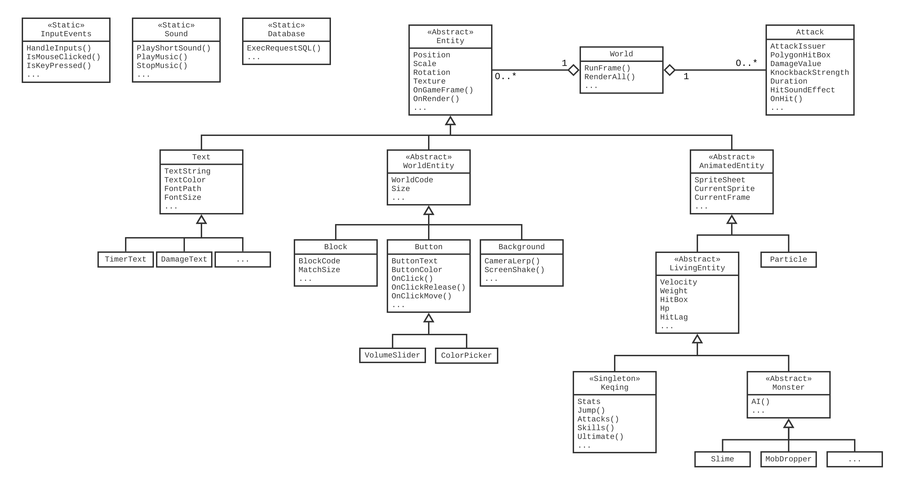

<div align="center">


A 2D game engine designed specifically for creating fighting games (e.g. Hack'N Slash). The engine is centered around the character [Keqing](#keqing-preview), who comes with dozens of unique skills.

https://github.com/user-attachments/assets/bd7f26c2-d13c-4cb9-9794-4ffa8184f4fb

</div>

## ⚙️ Game Engine

### Overview

- **Rendering** (Scene Display, Sprite Animation, Window Resizing...)
- **Camera** (Camera Lerping, Screen Shaking)
- **Entity Component System**
- **Physics** (Velocity, Gravity...)
- **Collision Detection System**
- **Particle System**
- **Attack System** (Polygon Collision, Knock-Backs...)
- **User Interface** (Text, Button, Slider, Color-Picker...)
- **Input Events** (Mouse, Keyboard)
- **Audio** (Sound Effects, Background Music)
- **Data Storage**
- **Debugging System** (HitBox Display, Frame-by-Frame Execution)

### KeqEngine UML Diagram



### Keqing Preview

https://github.com/user-attachments/assets/b932ac67-0bdc-4fef-8639-2faf0e8bcc26

### Game Example

Check out [```src/Main/```](src/Main/) for a complete example of how to use KeqEngine to create a game.

- **Menu**

https://github.com/user-attachments/assets/0f9da7c3-d1ed-4272-9916-8173f9e185cd

- **ExploSlime**

https://github.com/user-attachments/assets/3b03924f-9803-4aaf-be6f-a7fd5d793cb5

- **Slash'Em**

https://github.com/user-attachments/assets/5691be1a-e7ed-4214-bebc-e7782f12cc47


## 📥 Download

<div align="center">

[](https://github.com/PyroWilDx/KeqEngine/releases/)

</div>

## 🛠️ How To Build

- Initialize SQLite3.

```
cd data && sqlite3/sqlite3.exe Keqing.db < Init.sql
```

- Build w/ CMake.

```
cmake ..
cmake --build .
```

- Run `./bin/main`.

```
./bin/main
```

---

<div align="center">
  Copyright &#169; 2024 PyroWilDx. All Rights Reserved.
</div>
